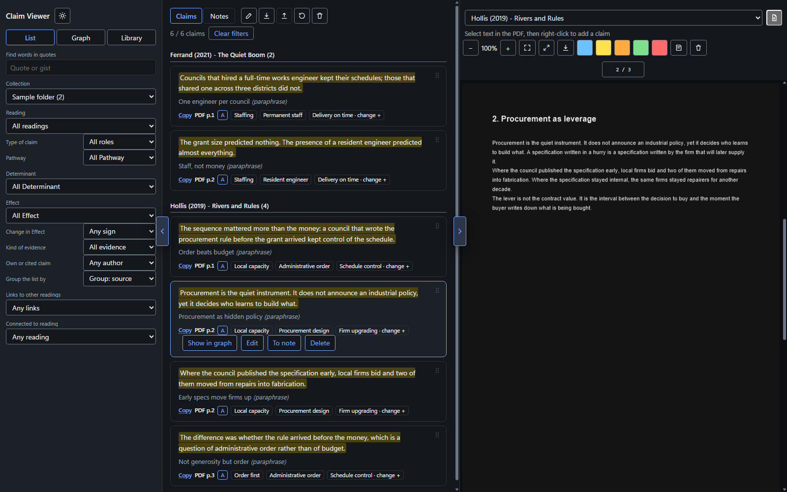
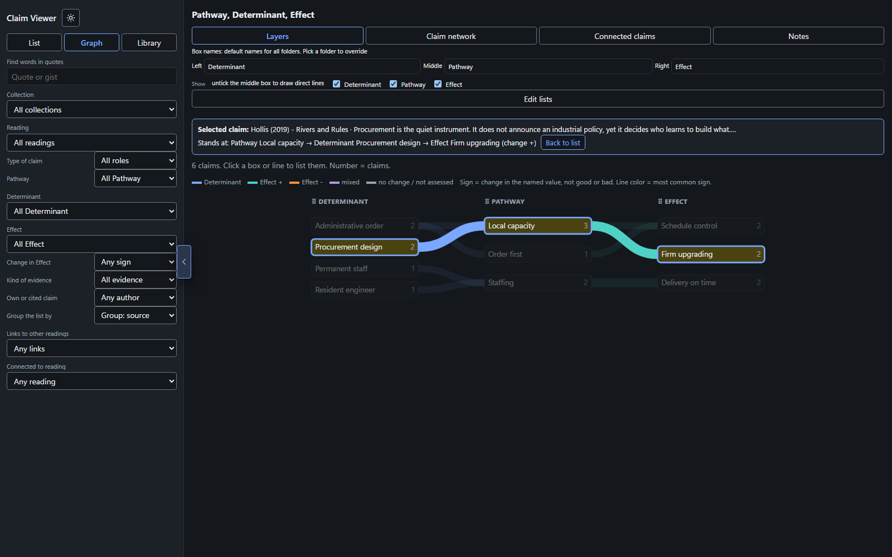
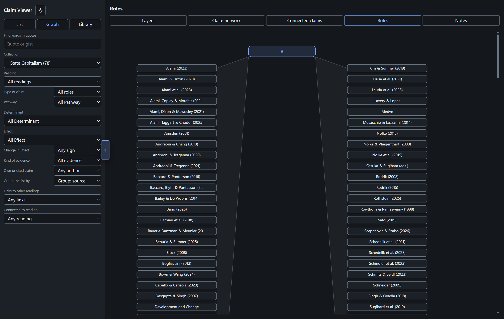
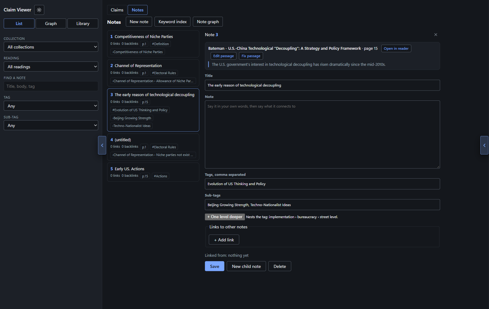
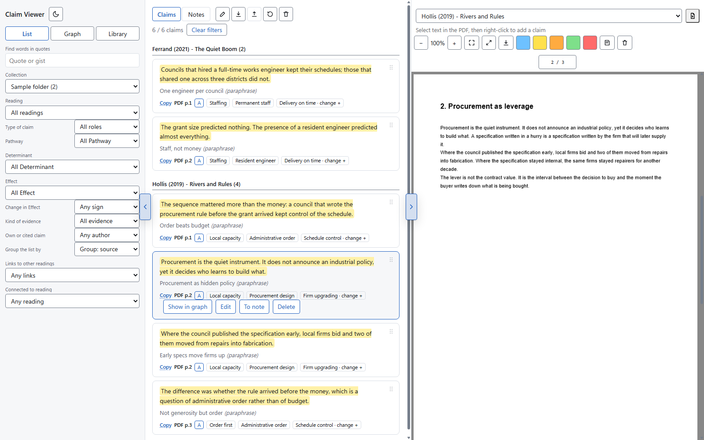
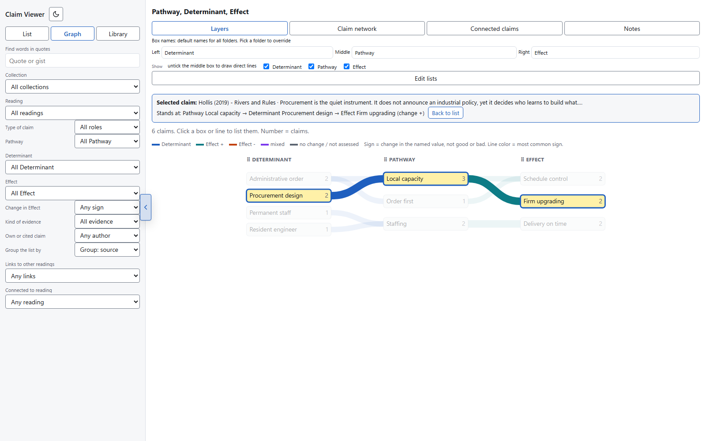
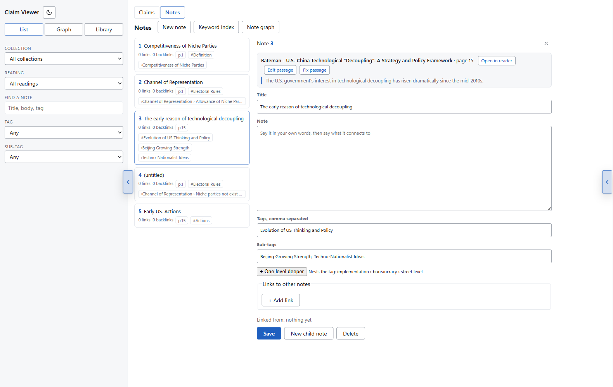
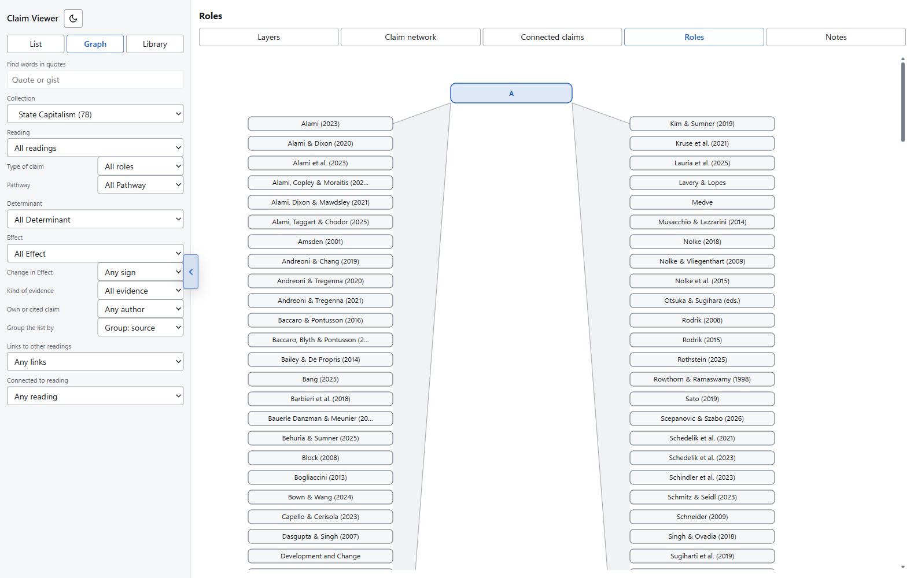

# Claim Viewer

Read a PDF, save passages as claims, tag them, connect them to other readings, keep Zettelkasten-style notes, ask AI about the text, and see how everything fits together in a graph. Cite any source in Microsoft Word without leaving the app. Your library is stored on your computer. When you use Ask AI or draft a graph, the relevant text is sent to your selected AI provider.

**[Download the installer](https://github.com/abd-azzam/Claim-Viewer/releases/latest)** — Windows 10/11, no Python needed.



*Sample data: both papers, their text and their claims are invented. The screenshots show an earlier release; every view they illustrate is still in the app.*

## Why this exists

Zotero keeps your PDFs and highlights, but it does not draw a graph of how the claims across your readings fit together, and it has no place for your own reading notes. Word can produce a citation, but not the sentence the citation rests on. This is a small viewer that does the reading, the tagging, the notes, the graph, the chat and the Word citation in one place. It was built with Claude Code and with Hermes (connected to DeepSeek Flash), under my supervision.

## Changes in 2.6.3

- OpenCode Go has its own provider preset, model catalog, and session header. The OpenCode preset uses the separate pay-as-you-go catalog. To refresh the list, select the saved provider in **Settings > AI**, click **Load available models**, then save. A model listed in one catalog may be unavailable in the other.
- Ask AI keeps passage explanations brief and uses the requested page when one is specified. It omits paragraphs without verified excerpts. Choose Fast or More complete citation checking in the composer.
- Citation jumps preserve PDF zoom when the viewer was hidden behind Ask AI.
- All five graph views offer AI drafting with review before saving.
- If Start shows two Claim Viewer shortcuts, open the one for the updated installation and check **Settings > About** for version 2.6.3. Older Program Files builds may lack OpenCode Go support. Back up or migrate their library before removing an old installation.

## Changes in 2.6.2

- The Word pane indents child folders, shows examples beside both citation forms, and accepts undated sources.
- The note editor leaves room at both sides and groups passage actions below the source title.
- Read Aloud uses the visible page margins, so cropped PDFs keep the opening paragraph.
- The Word citation service starts with its own runtime. The question mark beside Claim Viewer opens the tutorial.
- The Word pane puts source search first. Word uses the document's citation style and updates an existing bibliography after each insertion.
- Word repair restarts the citation service, and **Settings > Tutorial** opens the expanded guide.
- OCR shows the page being scanned and when it is writing text into the PDF. The scan options wrap to fit the dialog.
- The left pane toggle sits beside the theme button and the right toggle stays in the upper-right corner.
- AI Settings lists OpenAI and Claude (Anthropic). Each provider uses its own API key.
- About shows the installed version. Check for Updates checks GitHub on startup and downloads verified installers for newer stable releases. An in-app notice opens the update page when an installer is ready.
- Claim Viewer has a new Windows app icon.
- Adding a claim to an existing note opens the selected note, including the first or only match.
- OCR makes scanned text selectable in the reader and keeps word positions when you reopen the PDF. Rescan pages processed by an older build to save their positions.

For future updates, set the same version in `update_service.py` and `ClaimViewer.iss`, then attach `ClaimViewer-Setup-X.Y.Z.exe` to the public, stable GitHub release tagged `vX.Y.Z`.

## Changes in 2.6.1

- AI citation jumps use filled highlights with a visible border.
- Switching tabs or PDFs keeps the active chat available. Questions save immediately, and completed replies save to the reading that started the request.
- Provider connections stream returned reasoning and answer text. The writing state remains visible while citations are checked. Providers must support streaming; models can omit reasoning. Long readings processed in parts still use complete-response calls.

Close Claim Viewer after its active request finishes, then install this update and reopen it. Running requests do not resume after closing the app.

## What it does

### Library

- **Nested folders**, each reading filed in one or more collections. Add folder, rename, and import PDFs per folder. The reading menu, the list and the graph always follow the collection you picked.
- **Two views**: cards or a table. Both answer to the same filters, and the table sorts by any column heading — click again to reverse. Empty cells stay at the bottom.
- **Filter readings** over title, author, year, type, journal, volume, issue, pages, DOI, publisher and URL.
- **+ Add PDF** imports into the folder you picked, then asks for the title, author and year that the citation copies need.
- **DOI lookup** performs an exact lookup. A missing result field does not erase metadata you already typed.
- **Open the data folder** from Settings to see the files this installation uses.

### Reading

- **Read PDFs in the app** with zoom, fit width, and per-page rendering. Switching collection or PDF never reloads the app.
- **Turn pages**: the left and right arrow keys (or PageUp / PageDown) move one page; they are ignored while you type in a field or use the list.
- **Jump to a page**: the page box above the PDF is editable. It shows `8 / 50`; type a page number and press Enter to go there.
- **Resume where you left off.** The page is saved as soon as scrolling stops, and again when the window closes, so reopening a reading lands where you left it, even after a restart.
- **Full-screen reading**: one button in the zoom row hides everything but the PDF; Esc or the same button brings the panes back.
- **Define** a word from the right-click menu to get its English definition from Wiktionary. Results are cached, so repeat lookups work offline.
- **Highlight colours**, and *Save PDF* writes your highlights into the PDF as real highlight annotations.

### Claims

- **Save claims.** Select at least 20 characters, right-click, and choose **Add as claim**. Double-click a quote to fix its wording.
- **Name the roles yourself.** The Role ticks (A, B, TYPOLOGY, OTHER) carry a name you can type over in the claim editor. The new name is per collection, and the claim cards, the *Type of claim* filter and the Roles graph all follow it at once.
- **Renameable axes.** You name the left, middle and right graph columns (default Determinant / Pathway / Effect), per collection, in Edit lists.
- **Pathways work like the other tags.** In the claim editor, Pathways is a chip field exactly like Determinant and Effect: type a name and press Enter, or pick one of the suggestions. **The suggestions are exactly the pathway list of the collection you are in**, so a folder never offers another folder's terms. The **Lists** dialog keeps one plain text row per pathway; renaming a row renames it on every claim that carries it. Pathways are stored by name everywhere, never by an internal number.
- **Extra graph layers**: **+ Add section** in the Lists dialog adds a layer of its own, in the order you dragged the columns in the graph.
- **Links survive a rename.** If you rename a reading after connecting claims to it, the link retargets itself by title.
- **Connect claims across readings.** Link a claim to a specific claim in another reading, including readings outside the current folder. Four connection models, each with its own types and colours: *Stance* (supports / challenges / qualifies), *Causal* (causes / mediates / moderates / prevents), *Argument* (premise / rebuttal / counterexample / extension), *Bibliographic* (cites / extends / replicates / supersedes).
- **Copy with citation.** Each claim card has a **Copy** chip: it copies the sentence ending `(Author, Year, p. N)`, parsed from the reading's title.
- **One card, one shape.** Every card is Copy, the PDF page, the role and the pathway. A claim you wrote also shows its factor, outcome, direction, tags, evidence and section, and its paraphrase if you wrote one.
- **Attach a claim to a note with To note.** Select a claim card and press **To note**: add it to an existing note, or start a new note from it. The claim then reads as one more passage in the note, with its page. A claim belongs to one note at a time, so filing it elsewhere moves it.
- **Child notes** branch out of a note (`1a` under `1`, `1aa` under `1a`). A child is a full note, so it takes claims, tags, sub-tags and links like any other.
- **Filter and group** the list by the axes, pathways, direction, evidence, author, free text, reading, links, and collection.



### Graph

- **Layers** draws your named columns with a line wherever claims carry both tags. **Drag a column header onto another and the two columns swap places**; the order is saved for that collection. Empty-pathway links are blurred so the real structure stands out.
- **Claim network** links claims by similar wording or shared tags.
- **Connected claims** shows the declared cross-reading connections.
- **Roles** puts each role in the middle with the readings that carry it around it, and it uses the role names you set.
- **Zoom** in, out and fit from the graph toolbar, or hold Ctrl and use the wheel. A relayout drops the positions you dragged into place.



### Notes (Zettelkasten)



- The **Notes** tab sits beside Claims in the list. Each note quotes a passage, names its reading and page, and carries **tags and nested sub-tags** (`Mainstream Parties › Core Supporters` — depth is free).
- The **note graph** draws tag → sub-tag → note trees; untagged notes stay visible under "(no tag)".
- **The idea map groups by topic, by PDF source, or by both** (a source hull with the topic hulls inside it). This is the view to use when the question is which readings an idea connects, not which tag it belongs to.
- **Create nodes** writes a small set of connected propositions by hand, or drafts them with AI from a goal and a passage you paste. AI drafts are validated before they enter the graph, and you edit them before adding them.
- **Drag to fix mistakes**: drag a note onto a tag or sub-tag to re-file it; drag a node onto another of the same kind to swap them; drop in the strip just below a node to nest it there.
- **Undo** (this session only) and **Delete** sit in the graph toolbar: the node you clicked last is the one they act on.
- **Keyword index** lists every tag with the notes filed under it, and it answers to the same filters as the list beside it.
- **Delete asks first**, in the app's own dialog. **Closing keeps what you typed**, without pressing Save. A note you never fill in is discarded, so cancelling never uses up a number.
- **Note numbers follow the list you are looking at.** The first note in view is 1 and they run 1..N. The stored id never changes, so links and the graph stay correct.
- **Merged readings**: by default every note gets its own pill; *Merge readings* joins all notes of one reading into a single pill whose click opens a menu of its notes.

### Ask AI

The right pane has two tabs: **PDF** and **Ask AI**. The chat talks to your provider through the app, not the page, so no key ever appears in the HTML.

- **Connect a provider once** in **Settings > AI**: DeepSeek, OpenAI, Anthropic, OpenCode, or a custom OpenAI-compatible endpoint. Paste an API key, load the model list, pick a default. **Keys are encrypted for your Windows account** and never leave the machine except as the authorization header of one request.
- **Choosing a model.** The model list is loaded from the endpoint, and a model ID can be typed directly. Not every advertised model is served to every account: a rejected id says so. If catalog discovery fails, the saved model stays available.
- **Select a sentence in the PDF**, right-click, and choose **Ask AI**: the passage and its page go to the chat. You can also type your own question and send it.
- **Answers stream in.** Reasoning and answer text appear as the provider sends them, and the writing state stays up while citations are checked. Providers must support streaming; long readings processed in parts still use complete-response calls.
- **Every point carries a page chip.** A paragraph, or each bullet on its own, ends with a chip such as `p.3`. Click it and the reader opens that page, with a filled highlight and a visible border around the sentence. The chip's quote is checked against the page text before the chip is made, so a chip never names a page that does not contain its sentence.
- **The chat follows you.** Switching tabs or PDFs keeps the active chat available. A question is saved immediately, and a completed reply is saved to the reading that started it.
- **Thinking.** Expand the block above an answer for provider-supplied reasoning, when the model returns it. Some models return only an answer, and hidden internal reasoning is never available.
- Asking sends the PDF text and recent conversation to the provider you selected. The rest of the app still works offline.

### Word

- **A native ribbon**, installed from **Settings > Word Add-in > Install Word add-in**. No My Add-ins, no catalog share, no Python. Restart Word after installation.
- **Insert citation**, **Add bibliography**, **Refresh** and **Citation style**. Browse library folders or search, then choose parenthetical or narrative form and optionally a printed page.
- **American Political Science Association (APSA)** output is included; APA and Word's other installed styles remain available. Verified examples include `(Alami 2023, 12)` and `Alami (2023, 12)`.
- **Citations use native CITATION fields**; bibliography uses BIBLIOGRAPHY. Narrative citations omit titles, while the bibliography keeps them. Refresh repairs older Claim Viewer fields that included titles.
- **Actions are bound to the saved document** that hosts the pane, and reject mismatched or closed documents. Save the document before using the pane.
- Requires desktop Word for Windows (Office 2016 or later). Both bitnesses are packaged. Word for the web and macOS Word are not supported.

### Settings

One place for everything, from the button at the bottom of the left pane:

- **General**: startup behaviour, library view, and which sidebar sections show.
- **Appearance**: System, Dark or Light. Four dark palettes, four light ones, an accent colour, a font style, and an interface size from 80% to 125%.
- **AI**: providers and models.
- **Reference Managers**: export references as RIS for Zotero, Mendeley or EndNote. Automatic sync is not offered; PDFs and notes stay in this library.
- **Word Add-in**: install, repair, uninstall, and see whether the local service answers.
- **Cloud Sync & Backup**: create a local backup of the library, PDFs, claims, notes and reading positions, with API keys excluded. Automatic cloud sync is not connected.
- **Advanced**: open the data folder, export and import edits, restore the display defaults.
- **Feedback**: copy a diagnostic summary that excludes API keys and document text.

## Light theme

The same views in a light palette; the scheme is chosen in Settings > Appearance.

<details><summary>Show the light-theme screenshots</summary>









</details>

## Install

1. Download [`ClaimViewer-Setup-2.6.3.exe`](https://github.com/abd-azzam/Claim-Viewer/releases/latest) and run it. Python is not required.
2. Keep the suggested folder, or choose a writable one. Upgrades retain the previous installation folder.
3. Setup installs Microsoft Edge WebView2 if it is missing. That step needs an internet connection.
4. For desktop Word, select **Add Claim Viewer to Microsoft Word's ribbon**. Save documents and close Word before continuing, and approve the Windows administrator prompt.
5. Open **Claim Viewer** from Start. Open Word normally to see its **Claim Viewer** tab.

Requirements: Windows 10 x64 (1809 or later) or Windows 11. Word integration is optional and requires desktop Word for Windows, Office 2016 or later, with bibliography styles installed.

The installer carries an empty library, the offline PDF assets, the app and the Word component. It excludes the developer's PDFs, claims, conversations, API keys and local Word credentials. Reading and organizing work offline. AI, DOI lookup and online text-to-speech need their services; optional OCR needs Tesseract installed separately. Compare the hash from `Get-FileHash .\ClaimViewer-Setup-2.6.3.exe -Algorithm SHA256` with the `.sha256` file supplied alongside it.

**Windows SmartScreen.** The exe and the installer are unsigned, so the first run stops at *Windows protected your PC*. Only continue if the SHA256 matches: click **More info**, then **Run anyway**. Builds that you make yourself show the same prompt.

## Update and back up

Use Settings' backup action before updating. Save and close Word, and close Claim Viewer after its active request finishes. Run the new installer into the existing app folder. Library, PDFs and local state are preserved; the first launch refreshes the interface from the installed template while keeping the embedded research data, and `index.html.previous` keeps the prior page.

A legacy Program Files executable can point at another folder through `data-root.txt`. Library deletions update counts and keep recovery files in `data/deleted-readings`. Installations use separate data unless configured otherwise, so check which folder you opened when the library looks empty. Backup ZIPs exclude API credentials; Windows-protected keys are account-specific, so enter them again on another computer.

## Build a release

Maintainers need Windows x64, Python 3.11, Word's Office/Extensibility interop assemblies, the .NET Framework C# compiler and [Inno Setup 6](https://jrsoftware.org/isinfo.php).

```powershell
python -m venv .venv
.venv\Scripts\python -m pip install -r requirements-build.txt
powershell -ExecutionPolicy Bypass -File tools\build-release.ps1 -Python .venv\Scripts\python.exe
```

Override `-ISCC` if needed. The script builds the Word component and the executable, stages a fresh distribution, verifies the required assets and the account-data exclusions, checks Microsoft's WebView2 bootstrapper signature, compiles the setup and writes the SHA256. The Inno script refuses to package a `dist/index.html` larger than 1 MB, because a page that big is somebody's claims.

`build.py` fills the template's data payload from `library.json` and `data/claims/*.verified.json`:

```
python -I -X utf8 build.py
```

Installers are published as release assets and are no longer tracked in git. `dist/`, `index.html`, `library.json`, `sources.js` and `state.js` stay out too, because a built page holds somebody's claims.

## Files

| Path | Purpose |
|---|---|
| `template/template.html` | The whole interface. A built `index.html` is this file with its data filled in. |
| `launch.py` | The desktop app: a native WebView2 window around a local server, with the library API, AI chat and Word service. |
| `build.py` | Merges the library and the saved claims into `index.html`. |
| `startup_assets.py` | Refreshes the page from the template on upgrade without discarding embedded data. |
| `settings_service.py` | Settings and Word installation actions. |
| `cv_providers.py` | Provider connections, model catalogs, streaming and encrypted keys. |
| `word_service.py`, `word_citations.py` | Local Word service, citation fields and bibliography. |
| `library_tools.py` | Library files, DOI lookup and deletions. |
| `lib/` | Page scripts and styles, and the offline `pdf.js` / `pdf-lib` bundles. |
| `word/` | Word add-in sources: ribbon, pane, manifest template and install scripts. |
| `tools/` | Release pipeline (`build-release.ps1`, `stage-distribution.py`, `verify-distribution.py`) and the UI tests. |
| `release/` | The PyInstaller spec. Built installers go to the [Releases page](https://github.com/abd-azzam/Claim-Viewer/releases), not into git. |
| `docs/` | Screenshots used in this README, each in the dark and light theme. |

## Known limits

- Reading and saving PDFs works **offline**: `pdf.js` and `pdf-lib` ship in `lib/` next to the page, not from a CDN. The only network request the page makes for reading is a definition lookup, and only for a word that is not already in the local cache.
- Chat, provider protocol handling, PDF lifecycle and the thinking panel passed regression checks. Live requests with personal provider credentials, and installation on a separate clean Windows computer, remain unverified.
- A running request does not resume after the app closes, and it does not survive an update.
- Claim citations are parsed from the reading's title; if a title has no year the citation shows `(Author, p. N)`.
- A graceful close never loses your page. A force kill or a power cut can still lose the last instant, because nothing runs at that moment.
- Undo in the note graph is deliberately not saved: a stored stack once rewound the notes to a days-old state.
- If a reader file goes missing the page says which one and still shows the PDF in a plain frame, so no case leaves a blank pane.
- Models can return no reasoning. That is not an error, and the saved model stays available when catalog discovery fails.
- Word actions need a saved document; an unsaved document cannot host the pane.
- Do not commit copyrighted PDFs. `.gitignore` keeps `pdf/`, `data/`, `library.json`, `state.js`, `sources.js`, `ai.json` and `providers.json` out of the repository.

## License

[MIT](LICENSE)
