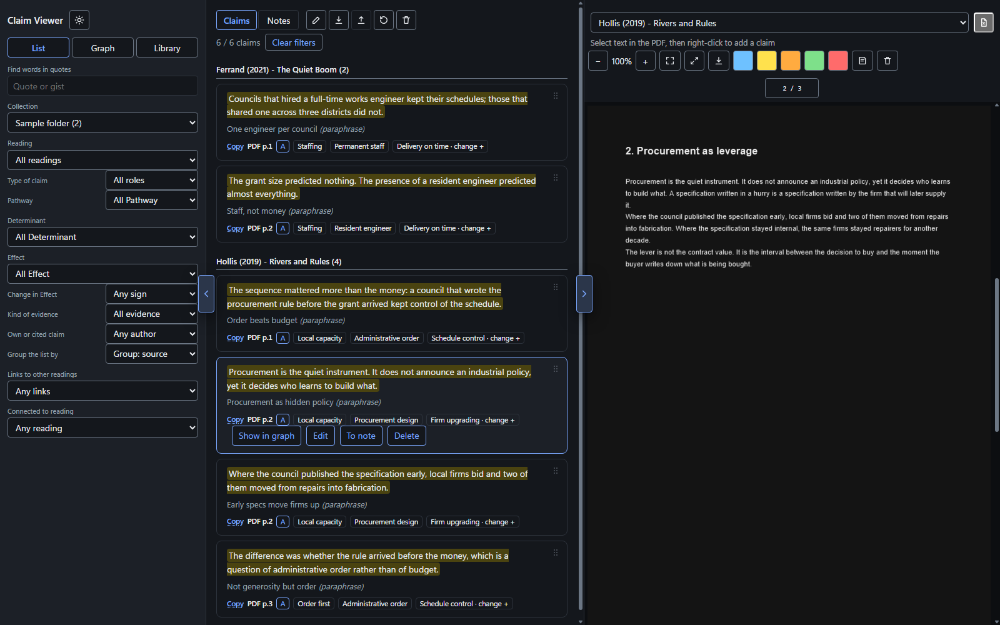
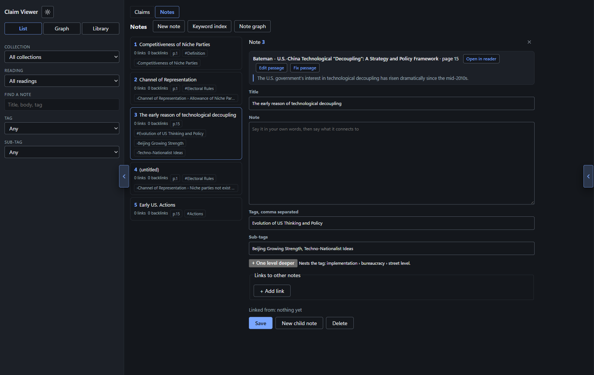
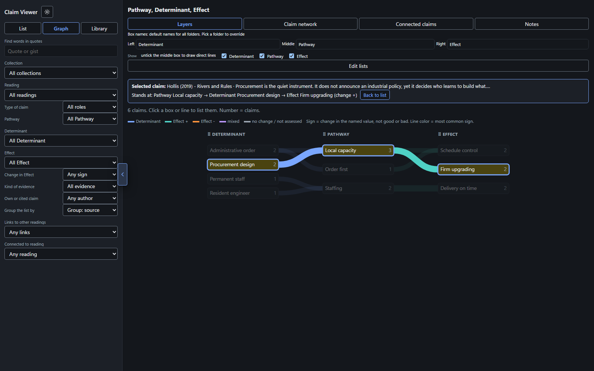
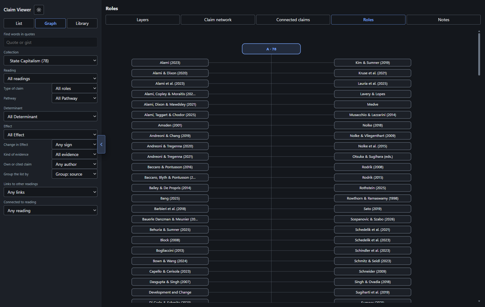
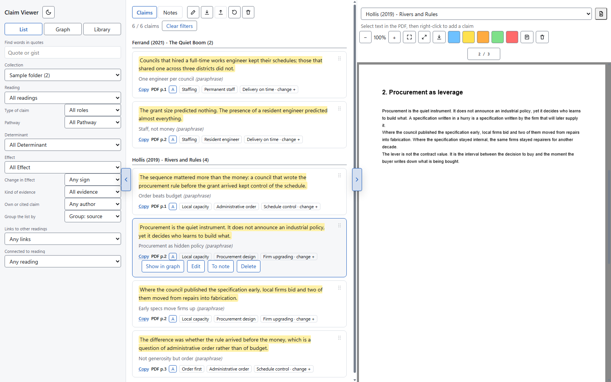
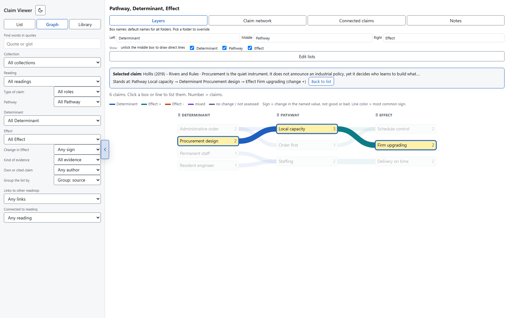
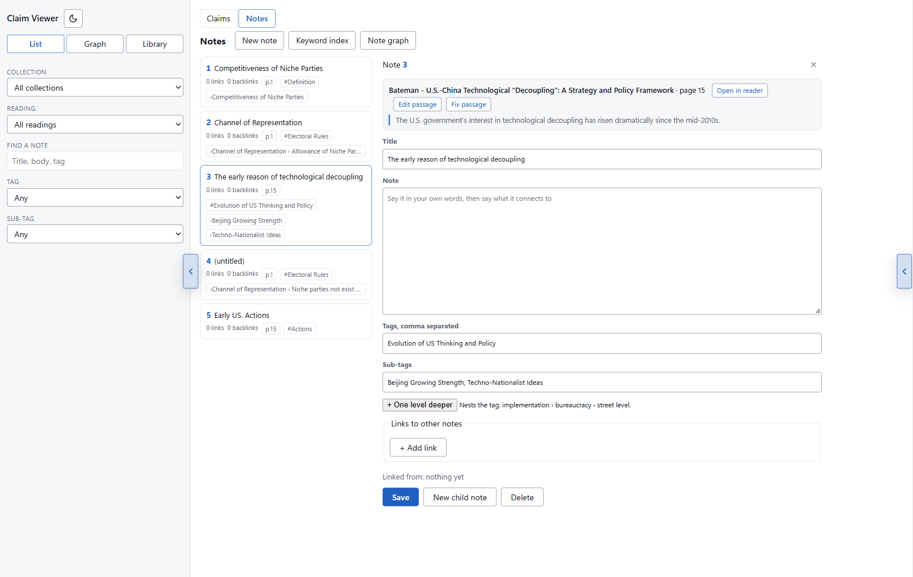
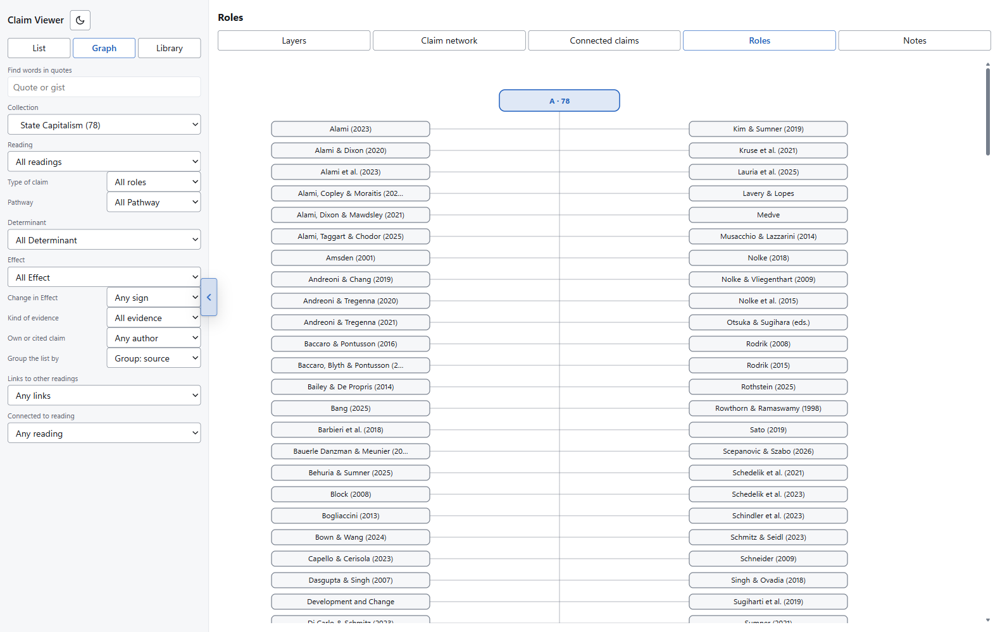

# Claim Viewer

Read a PDF, save passages as claims, tag them, connect them to other readings, keep Zettelkasten-style notes, and see how everything fits together in a graph. It runs on your own computer: your PDFs, claims and notes are never uploaded.



*Sample data: both papers, their text and their claims are invented.*

## Why this exists

Zotero keeps your PDFs and highlights, but it does not draw a graph of how the claims across your readings fit together, and it has no place for your own reading notes. This is a small viewer that does the reading, the tagging, the notes and the graph in one place. It was built with Claude Code and with Hermes (connected to DeepSeek Flash), under my supervision.

## What it does

### Reading

- **Library** like Zotero: nested folders, each PDF filed in one or more collections, with add-folder, rename, and per-folder PDF import. The reading menu, the list and the graph always follow the collection you picked.
- **Read** PDFs in the app with zoom, fit width, and per-page rendering. Switching collection or PDF never reloads the app.
- **Turn pages**: the left and right arrow keys (or PageUp / PageDown) move one page; they are ignored while you type in a field or use the list.
- **Jump to a page**: the page box above the PDF is editable. It shows `8 / 50`; type a page number and press Enter to go there.
- **Resume where you left off.** The page is saved as soon as scrolling stops, and again when the window closes, so reopening a reading lands where you left it, even after a restart.
- **Full-screen reading**: one button in the zoom row hides everything but the PDF; Esc or the same button brings the panes back.
- **Dictionary**: right-click any word in the claim or note lists (or pick a single word in the PDF and choose *Define*) for its English definition from Wiktionary. Results are cached, so repeat lookups work offline.
- **Four highlight colors**, and *Save PDF* writes your highlights into the PDF as real highlight annotations.

### Claims

- **Save claims.** Select 20 or more characters, right-click, and choose **Add as claim** (or press Alt+A). Double-click a quote to fix its wording.
- **Name the roles yourself.** The Role ticks (A, B, TYPOLOGY, OTHER) carry a name you can type over in the claim editor: click the word, type, press Enter. The new name is per collection, and the claim cards, the *Type of claim* filter and the Roles graph all follow it at once. Escape puts the old name back.
- **Renameable axes.** The old fixed Q1/Q2 is gone: you name the left, middle and right graph columns (default Determinant / Pathway / Effect), per collection, in Edit lists.
- **Pathways work like the other tags.** In the claim editor, Pathways is a chip field exactly like Determinant and Effect: type a name and press Enter, or pick one of the suggestions. **The suggestions are exactly the pathway list of the collection you are in**, the same list the Lists dialog shows for it, so a folder never offers another folder's terms. A name you invent is part of that list from then on. The **Lists** dialog keeps one plain text row per pathway; renaming a row renames it on every claim that carries it. Pathways are stored by name everywhere, never by an internal number.
- **Extra graph layers**: **+ Add section** in the Lists dialog adds a layer of its own; the button always sits on its own line below the sections, the ✕ on a section removes it, and the dialog lists columns in the order you dragged them in the graph.
- **Links survive a rename.** If you rename a reading after connecting claims to it, the link retargets itself by title, so the Connected claims view keeps its arrows.
- **Connect claims across readings.** In the claim editor, link a claim to a specific claim (and its paragraph) in another reading, including readings outside the current folder. Four connection models, each with its own types and colors: *Stance* (supports / challenges / qualifies), *Causal* (causes / mediates / moderates / prevents), *Argument* (premise / rebuttal / counterexample / extension), *Bibliographic* (cites / extends / replicates / supersedes).
- **Copy with citation.** Each claim card has a **Copy** chip: it copies the sentence ending `(Author, Year, p. N)`, parsed from the reading's title. Alt+click a card does the same.
- **One card, one shape.** Every card is Copy, the PDF page, the role and the pathway. A claim you wrote also shows its factor, outcome, direction, tags, evidence and section, and its paraphrase if you wrote one. A claim that came from the extractor shows none of those and no paraphrase, because a script wrote them. A `failed` or `ambiguous` chip appears only when the saved quote could not be matched against the PDF text.
- **To note files the note in the graph.** A note started from a claim takes the claim's pathway as its tag, so it lands under that branch in the note graph instead of "(no tag)".
- **Connections live in Notes.** The old "other papers: similar / opposite sign" list under a selected card is gone. Use **To note** on a claim to keep the link in its note, where the note graph shows it.
- **Filter and group** the list by the axes, pathways, direction, evidence, author, free text, reading, links, and collection.

### Notes (Zettelkasten)



- The **Notes** tab sits beside Claims in the list. Each note quotes a passage, names its reading and page, and carries **tags and nested sub-tags** (`Mainstream Parties › Core Supporters` — depth is free).
- The **note graph** (Graph → Notes) draws tag → sub-tag → note trees; untagged notes stay visible under "(no tag)".
- **Drag to fix mistakes**: drag a note onto a tag or sub-tag to re-file it; drag a node onto another of the same kind to **swap** them (any level, tag↔tag included); drop in the strip just below a node to nest it there. The open editor's fields follow every move.
- **Undo** (30 steps, this session only) and **Delete** (the node you clicked last: note, tag or sub-tag) sit in the graph toolbar, deliberately small and right-aligned so they never compete with the mode tabs. Undo does not survive a restart: a saved stack once rewound the notes to a days-old state.
- **Keyword index** lists every tag with the notes filed under it, and it answers to the same filters as the list beside it: the collection, the reading, the tag, the sub-tag and the text box. Pick a collection and it shows only that collection's keywords; type in *Find a note* and it narrows to those notes.
- **Delete asks first**, with **Cancel** and a *Do not ask me again* tick, in the app's own dialog.
- **Closing keeps what you typed**, title and body included, without pressing Save.
- **A note you never fill in is discarded.** Closing an untouched note removes it, so cancelling never uses up a number. A note started while a folder is selected stays in that folder even before you attach a reading.
- **Note numbers follow the list you are looking at.** The first note in view is 1 and they run 1..N, so a folder with two notes shows 1 and 2, never 3 and 5. The stored id never changes, so links and the graph stay correct; child notes still branch as 1a, 1aa.
- **Merged readings**: by default every note gets its own pill; *Merge readings* joins all notes of one reading into a single pill whose click opens a menu of its notes with their branches.



### Graph

- **Layers** draws your named columns with a line wherever claims carry both tags. Empty-pathway links are blurred so the real structure stands out. Graph controls (Show checkboxes, box names, Edit lists) belong to Layers only and are not rendered in the other modes.
- **Claim network** links up to 60 claims at a time by similar wording or shared tags.
- **Connected claims** shows the declared cross-reading connections.
- **Roles** puts each role in the middle with the readings that carry it around it: the role pill on top, a spine down, one arm to every reading with a claim of that role. The reading pill's tooltip gives the number of such claims. It follows the collection, reading, role and every other filter, and it uses the role names you set.


- The horizontal scrollbar sits at the bottom edge of the window, not floating mid-panel.

### Safety rails

- **Clear filters** and **Clear all** are separate: Clear all deletes only the open reading's claims and highlights, after a confirmation in the app's own dialog (never a browser popup).
- **Export and import** your edits as `claim-edits.json` (download and upload buttons).

### Light theme

The same views in the light theme; the toggle sits next to the title.

<details><summary>Show the light-theme screenshots</summary>









</details>

## Use it without installing anything

1. Copy the [`reader/`](reader) folder anywhere.
2. Put your PDFs in `reader/pdf/`.
3. List each PDF in `reader/sources.js` (`id` = the file name without `.pdf`); **name every PDF with author, year and title** — the citation copy parses them from the title, for example `Alami (2023) - Ten theses on the new state capitalism`. Replace the placeholder `smith-2020` line:
   ```js
   window.SOURCES=[
     {id:"smith-2020", title:"Smith (2020) - Why States Build Capacity"},
   ];
   ```
4. Double-click `reader/index.html`.

When you open it by double-click, the browser cannot read the `pdf` folder by itself. The first time, a yellow banner asks you to pick the `pdf` folder. Only Chromium-based browsers (Chrome, Edge) have been checked; others may work but are untested.

## Use it as a Windows app

1. Download [`ClaimViewer-Setup-2.1.0.exe`](release/ClaimViewer-Setup-2.1.0.exe) and run it.
2. Pick the folder (default: `C:\Apps\ClaimViewer`). A Desktop shortcut is offered but not ticked; the Start menu shortcut is always added.
3. Put your PDFs in the `pdf` folder inside it and list them in `sources.js`.
4. Open **Claim Viewer** from the Start menu. It opens its own window (no browser), centred on the screen and shrunk to fit if the screen is small, and stops when you close it.

The install folder is also the viewer folder: the app serves the `index.html` that sits next to `ClaimViewer.exe`. To use a viewer you built with `build.py`, replace `index.html` there. Setup never overwrites `index.html` or `sources.js`, and never deletes them, `pdf`, or your saved claims when you upgrade or uninstall.

Needs the Microsoft WebView2 runtime (already on Windows 11 and current Windows 10). Confirmations are drawn inside the app, never by Windows and never by the browser. The two file dialogs (import PDFs, save PDF) are native Windows dialogs owned by the app window, so they cannot open behind it, and the page gives up after two minutes instead of waiting forever.

## Build the installer yourself

```
build_exe.bat
```

Needs Python 3 and [Inno Setup 6](https://jrsoftware.org/isinfo.php) (`winget install JRSoftware.InnoSetup`). The script refreshes `reader/index.html` from `template.html`, **wipes `dist/`**, builds `dist/ClaimViewer.exe` (PyInstaller), stages `dist/` with the empty reader page and the pdf.js libs, then writes `release/ClaimViewer-Setup-<version>.exe`. The Inno script refuses to package a `dist/index.html` larger than 1 MB, because a page that big is somebody's claims. Change the version in `ClaimViewer.iss`. Git tracks only `release/ClaimViewer-Setup-*.exe`: `dist/` and `index.html` stay out, because a built page holds somebody's claims.

## Check the installer without touching your install

```
python test_installer.py
```

Builds the setup with a throwaway AppId and the name **Claim Viewer (test)**, installs it into a temp folder, checks that the packaged page carries zero readings and that `pdf.js` is there, then uninstalls and deletes the folder. The uninstaller deletes shortcuts by name, so a test built under the real name would remove your own Start-menu entry; this one cannot.

The script closes a running Claim Viewer first (a silent install aborts with exit code 5 while the app holds its files) and starts it again when the test is done.

## Optional: fill the viewer with claims you prepared

If you already have claims as quotes in JSON (written by hand, or extracted by a script or an AI assistant), `build.py` merges them with the library and builds a ready-filled `index.html`. You do not need this to use the viewer.

```
pip install -r requirements.txt
python verify.py        # checks every quote against the PDF text
python build.py         # writes index.html (library.json + data/claims/*.verified.json)
```

Run these from the project folder (the one that holds `template.html`). `build.py` also accepts `--from <dir>`, which reads that folder's `library.json` and `data/` and writes `index.html` beside `build.py`; this is how the repo was checked against the installed app (identical bytes). `python app/make_reader.py` rebuilds `reader/index.html` from `template.html` and `vocab.starter.json`. `build.py` reads:

| Input | What it is |
|---|---|
| `library.json` | The Zotero-style library: `{items, collections}`, nested collections with `parent`, each item listed under `collections[]`. PDFs are copied into `pdf/`. |
| `data/claims/<id>.verified.json` | `{"claims": [{"id", "quote", "role", "pathway", ...}]}`. Pathways are stored **by name**; `build.py` converts any legacy numeric ids with the vocabulary map. Other fields: `gist`, `axisA`, `axisB`, `evidence`, `own_claim`, `direction`, `section`, `links`. |
| `data/vocab.json` | The pathway, axis and role lists. Pathway keys are names. |

`verify.py` marks each quote `exact`, `anchored`, `ambiguous` or `failed`, writes `data/claims/<id>.verified.json`, and a copy of the PDF with the quotes highlighted to `pdf/<id>.pdf`. `build.py` also fills `DATA.schema` (the axis names) and `DATA.models` (the four connection models).

## Files

| Path | Purpose |
|---|---|
| `template.html` | The whole viewer. A built `index.html` is this file with its data filled in. |
| `reader/` | A ready, empty viewer to start from: `index.html`, `sources.js` and an empty `pdf/` folder. `app/make_reader.py` regenerates `index.html` from `template.html` + `vocab.starter.json`. |
| `index.html` | Generated by `build.py` and git-ignored: it holds your claims, so it never enters the repo. |
| `build.py` | Merges `library.json` + `data/claims/*.verified.json` into `index.html`. |
| `verify.py` | Quote-against-PDF checker (see above). |
| `app/launch.py` | The Windows app: a native window (WebView2) around a small local server, with the library import/copy API. |
| `app/make_reader.py` | Rebuilds `reader/index.html` from `template.html`. |
| `app/setup_shortcuts.py` | Small shortcut-only setup helper (the installer covers this). |
| `release/` | The prebuilt, unsigned Windows installer. The exe it packs is built into `dist/`. |
| `test_installer.py` | Builds a throwaway installer, installs it to a temp folder, checks the packaged page and libs, then removes it (see above). |
| `ClaimViewer.iss`, `build_exe.bat` | Inno Setup script and build script for the Windows installer. |
| `vocab.thesis.json` | An example vocabulary. |
| `docs/` | Screenshots used in this README: claim list, graph, notes and roles, each in the dark and light theme. |

## Known limits

- Reading and saving PDFs works **offline**: `pdf.js` and `pdf-lib` ship in `lib/` next to the page, not from a CDN. The only network request the page makes is a dictionary lookup on Wiktionary, and only for a word that is not already in the local cache. A lookup that fails (offline, timeout) is not cached, so the same word is tried again next time.
- Your edits live in the browser or app storage for that folder. The Windows app keys storage to the folder path, so moving the folder loses them: use Export first, then Import.
- Claim citations are parsed from the PDF title; if a title has no year the citation shows `(Author, p. N)`.
- The merged-reading pill in the note graph joins a reading's notes into one node; chains that share a reading but sit on different branches all point at that node. Turn *Merge readings* off to keep every note separate.
- Undo in the note graph holds 30 steps **for the current session only**: it is deliberately not saved, because a stored stack once rewound the notes to a days-old state.
- Save PDF writes a copy of the PDF with your highlights as real highlight annotations. The app opens a PDF-only save dialog.
- A graceful close never loses your page. A force kill or a power cut can still lose the last instant, because nothing runs at that moment.
- If a reader file goes missing the page says which one and still shows the PDF in a plain frame: `lib/pdf.min.js` missing is caught before parsing starts, and a missing `lib/pdf.worker.min.js` is caught when the reader fails to start. A damaged PDF reports that instead. No case leaves a blank pane.
- In the Notes tab the list sits beside the note when the PDF pane is closed. With the PDF pane open on a narrow window the list drops below the note; close the PDF pane to get the two-column view.
- The window opens centred on the **primary** screen, not on whichever monitor holds the cursor.
- The exe and the installer are unsigned, so Windows SmartScreen may warn.
- Do not commit copyrighted PDFs. `.gitignore` already skips `reader/pdf/*.pdf` and the pipeline's `pdf/`, `papers/` and `claims/` folders.

## License

[MIT](LICENSE)
